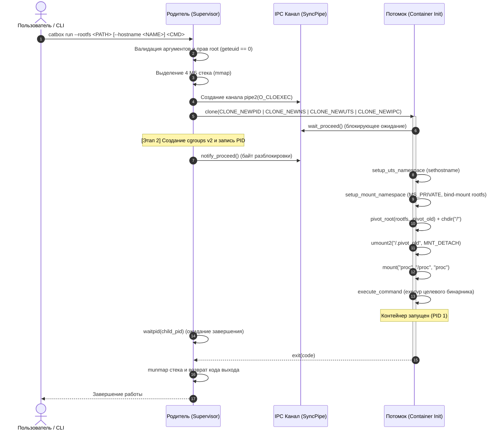

# catbox

Легковесный контейнерный рантайм на C++17 для Linux, реализующий изоляцию процессов на базе механизмов ядра (Namespaces, `pivot_root`), ограничение вычислительных ресурсов через cgroups v2 и сбор телеметрии.

Проект исследует и реализует низкоуровневые примитивы операционной системы Linux, лежащие в основе промышленных OCI-рантаймов (`runc`, `crun`), без использования сторонних демонов (демонических прослоек вроде dockerd).

---

## Архитектура и принципы работы

Рантайм спроектирован по двухпроцессной модели: родительский процесс-супервайзер на хосте и изолированный дочерний процесс контейнера, синхронизируемые через IPC (анонимный канал `pipe2`):



---

## Структура проекта

```
catbox/
├── CMakeLists.txt         # Конфигурация сборки CMake (C++17, -Wall, -Wextra)
├── include/
│   ├── cli.hpp            # Парсер аргументов командной строки и справка
│   ├── container.hpp      # Структура конфигурации ContainerConfig
│   ├── isolation.hpp      # Интерфейс изоляции и порождения процессов
│   └── sync.hpp           # RAII-обертка над IPC-каналом синхронизации (pipe2)
├── src/
│   ├── cli.cpp            # Реализация разбора флагов CLI и валидации
│   ├── isolation.cpp      # Системные вызовы clone, pivot_root, sethostname, execvp
│   ├── main.cpp           # Точка входа в утилиту
│   └── sync.cpp           # Реализация межпроцессной синхронизации (SyncPipe)
└── scripts/
    └── fetch_rootfs.sh    # Загрузка и подготовка минимального rootfs (BusyBox)
```

---

## Ключевые компоненты изоляции (Этап 1 — Готов)

1. **Изоляция пространств имён (Namespaces):**
   - **PID (`CLONE_NEWPID`)** — отдельное дерево процессов. Первый запущенный внутри контейнера процесс получает `PID = 1`.
   - **Mount (`CLONE_NEWNS`)** — собственная независимая таблица точек монтирования.
   - **UTS (`CLONE_NEWUTS`)** — собственное сетевое имя хоста (`hostname`), не влияющее на хостовую систему.
   - **IPC (`CLONE_NEWIPC`)** — изолированные очереди сообщений POSIX/SysV и разделяемая память.

2. **Изоляция файловой системы (`pivot_root`):**
   - Перевод всех точек монтирования в приватный режим (`MS_REC | MS_PRIVATE`), предотвращающий утечку монтирований на хост.
   - Превращение каталога `rootfs` в точку монтирования через bind mount (`MS_BIND | MS_REC`).
   - Атомарная подмена корня системным вызовом `pivot_root(2)` с перемещением хостового корня в скрытую временную директорию.
   - Переход в новый корень (`chdir("/")`) и полное отсоединение старого хостового корня через `umount2(..., MNT_DETACH)`.
   - Монтирование виртуальной псевдофайловой системы `/proc` (`MS_NOSUID | MS_NODEV | MS_NOEXEC`), отображающей только изолированные процессы контейнера.

3. **Синхронизация процессов (IPC SyncPipe):**
   - Гарантирует отсутствие гонки (race condition) между родителем и потомком: потомок не начинает менять файловую систему и исполнять код, пока родитель не подтвердит готовность окружения.

4. **Запуск команд (`execvp`):**
   - Безопасное замещение процесса контейнера целевым исполняемым файлом (например, `/bin/sh`) с сохранением дескрипторов ввода/вывода (терминала).

---

## Системные требования

- **Операционная система:** Linux с ядром $\ge$ 5.8 (для поддержки unified hierarchy cgroups v2).  
  *На Windows разработка и запуск производятся через **WSL2** (Ubuntu).*
- **Компилятор:** GCC $\ge$ 8 или Clang $\ge$ 7 с поддержкой C++17.
- **Система сборки:** CMake $\ge$ 3.16.
- **Привилегии:** Права суперпользователя (`root` / `sudo`) для вызовов `clone`, `pivot_root` и `mount`.

---

## Сборка и запуск

### 1. Подготовка окружения (в Linux / WSL2 Ubuntu)

```bash
sudo apt update && sudo apt install -y build-essential cmake curl libcap-dev
```

### 2. Подготовка минимального rootfs (BusyBox)

```bash
chmod +x scripts/fetch_rootfs.sh
./scripts/fetch_rootfs.sh
```

### 3. Сборка проекта

```bash
cmake -B build -DCMAKE_BUILD_TYPE=Release
cmake --build build
```

### 4. Запуск изолированного контейнера

```bash
# Запуск интерактивного шелла с собственным именем хоста
sudo ./build/catbox run --rootfs .rootfs/busybox --hostname mybox /bin/sh
```

**Проверка изоляции внутри контейнера:**
```sh
/ # hostname
mybox

/ # ps
PID   USER     TIME  COMMAND
    1 root      0:00 /bin/sh
    2 root      0:00 ps

/ # ls -la /
drwxr-xr-x    2 root     root          4096 bin
drwxr-xr-x    2 root     root          4096 dev
drwxr-xr-x    2 root     root          4096 etc
dr-xr-xr-x   11 root     root             0 proc
drwxr-xr-x    2 root     root          4096 sys
```

---

## Дорожная карта разработки (Roadmap)

- [x] **Этап 1: Базовая изоляция и запуск процессов (MVP) — ВЫПОЛНЕН**
  - [x] Настройка сборочной системы `CMakeLists.txt` под C++17 (`_GNU_SOURCE`).
  - [x] Каркас CLI точки входа (`main.cpp`, `cli.cpp`) и валидация привилегий `root`.
  - [x] Скрипт скачивания и распаковки тестового rootfs (`busybox`).
  - [x] Структура конфигурации контейнера `ContainerConfig` и парсер аргументов.
  - [x] Канал синхронизации родителя и потомка `SyncPipe` на базе `pipe2(O_CLOEXEC)`.
  - [x] Порождение процесса в пространствах имён (`clone`: PID, Mount, UTS, IPC).
  - [x] Изоляция ФС: `pivot_root`, безопасное отмонтирование старого корня, монтирование `/proc`.
  - [x] Изоляция имени хоста (UTS) и запуск целевой команды (`execvp`).

- [ ] **Этап 2: Контроль ресурсов и cgroups v2**
  - [ ] Автоматическое создание cgroup в `/sys/fs/cgroup/catbox/<id>`.
  - [ ] Ограничение оперативной памяти (`memory.max`).
  - [ ] Ограничение процессорного времени (`cpu.max`).
  - [ ] Ограничение числа процессов для защиты от fork-бомб (`pids.max`).
  - [ ] Привязка PID потомка в `cgroup.procs` до разблокировки `SyncPipe`.
  - [ ] RAII-очистка директории cgroup при завершении контейнера.

- [ ] **Этап 3: Поддержка спецификации OCI (config.json) и безопасность**
  - [ ] Интеграция легковесного JSON-парсера (`nlohmann/json`).
  - [ ] Команда `catbox spec` для генерации стандартного шаблона спецификации `config.json`.
  - [ ] Поддержка запуска из OCI Bundle (`catbox run --bundle <PATH>`).
  - [ ] Сброс опасных POSIX capabilities (`libcap`).
  - [ ] Запрет повышения привилегий через `prctl(PR_SET_NO_NEW_PRIVS)`.
  - [ ] Безопасное монтирование узлов `/dev` (`null`, `zero`, `urandom`).

- [ ] **Этап 4: Телеметрия, бенчмарки и отчет**
  - [ ] Сбор метрик ресурсов из cgroupfs (`cpu.stat`, `memory.current`, `memory.peak`).
  - [ ] Вывод статистики после завершения работы контейнера.
  - [ ] Стресс-тестирование изоляции и лимитов.
  - [ ] Сравнение времени старта с промышленным `runc`.
